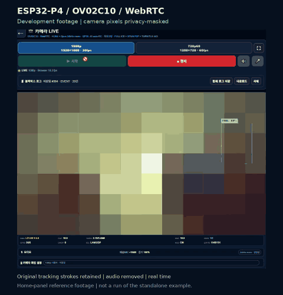

# ESP32-P4 OV02C10 WebRTC H.264 Camera

## Development footage

[](docs/demo/home-panel-tracking-demo.mp4)

[Watch/download the 30-second MP4](docs/demo/home-panel-tracking-demo.mp4).
This is a continuous excerpt from the existing home-panel development recording,
with camera imagery heavily pixelated, browser chrome cropped and audio removed.
Green/cyan tracking strokes are retained. It is not a recording of the standalone
example and is not an image-quality, frame-rate or recognition-accuracy benchmark.
[Footage and privacy notes](docs/demo/README.md).

## Start here: buildable example

[OV02C10 WebRTC example](examples/ov02c10_webrtc/README.md) prepares a separate
ESP-IDF application from a pinned public Espressif example, with an external
OV02C10 driver and local-only Wi-Fi/HTTPS settings. Start with that baseline,
then use the optimized source snapshots under `src/` as integration references.

한국어: [예제 안내](examples/ov02c10_webrtc/README_KO.md).

## Snapshot update — 2026-11-05

Updated camera/ISP, WebRTC, Opus capture, H.264 encoder and browser face detection, multi-face tracking and experimental OWNER code. This remains an extracted reference bundle, not a standalone build. See [scope and validation](docs/SNAPSHOT_20261105.md). No personal face data or private deployment settings are included.


Production-oriented reference files for an ESP32-P4 camera stream using:

- OV02C10 camera input
- ESP32-P4 hardware H.264 encoder
- WebRTC browser playback
- Opus 24 kHz mono audio
- STUN plus TURN fallback
- 1080p and 720p60 profile switching
- QP/GOP profiles tuned for Wi-Fi and LTE
- Per-profile ISP/color tuning with NVS persistence
- 1080p and 720p60 color auto-calibration

This is not a clean standalone ESP-IDF example yet. It is a public release
bundle of the camera/WebRTC/H.264 parts extracted from a larger home panel
project.

## Proven Profiles

| Profile | Resolution | Target Network | QP | GOP | Notes |
|---|---:|---|---:|---:|---|
| 720p60 | 1288x728 | Local/Wi-Fi | 39 | 8 | Lower bitrate, high displayed FPS |
| 1080 Wi-Fi | 1920x1080 | Wi-Fi | 30 | 5 | Best visual quality target |
| 1080 LTE | 1920x1080 | About 1 Mbps LTE | 32 | 15 | Stable field result around 20 fps class |

Observed LTE result for `QP32/GOP15`:

```text
30.04 s
615 frames
20.47 fps
620 kbps H.264 payload
IDR 41
P 574
loss 0%
queue drop 0
```

## Important Fix

The most important H.264 encoder fix is the fixed-QP delta sync path:

```c
esp_h264_enc_hw_active_set_fixed_qp(uint8_t qp)
```

When the encoder was created with one QP and then changed live to another fixed
QP, the hardware QP and slice-signaled QP could diverge. That produced dark
soot-like artifacts at `QP30/GOP5` or `QP30/GOP8`.

The fix keeps PPS `pic_init_qp` stable and signals:

```text
slice_qp_delta = live_fixed_qp - qp_init
```

This removed the artifact without closing and reopening the camera or encoder.

## ISP and Color Auto-Calibration

The browser UI includes per-profile image tuning and auto-calibration:

| Profile | Calibration Target | Storage |
|---|---:|---|
| 1080p | 1920x1080 raw/ISP sampling path | 1080p profile NVS values |
| 720p60 | 1288x728 raw/ISP sampling path | 720p60 profile NVS values |

The auto-calibration path samples camera data before H.264 compression. It is
therefore not directly affected by the current GOP value displayed in the live
stream status line. GOP/QP tune network compression; ISP/color calibration tunes
the image source feeding the encoder.

## TURN Credentials

The public copy uses placeholders:

```text
turn.example.com
YOUR_TURN_USER
YOUR_TURN_PASSWORD
```

Replace these in:

- `src/main/camera_live.html`
- `src/main/web_smoke.c`

Do not commit real TURN credentials or private hostnames.

## Source Layout

```text
src/main/
  camera_live.html
  web_smoke.c
  camera_csi_diag.c
  camera_csi_diag.h

src/components/espressif__esp_h264/hw/
  src/esp_h264_enc_single_hw.c
  src/esp_h264_enc_hw_param.c
  include/esp_h264_enc_single_hw.h
  src/esp_h264_enc_hw_param.h

docs/
  QP_GOP_TUNING.md
  DMA_MEMORY_NOTES.md
  WEBRTC_FLOW.md
  ISP_COLOR_AUTOCAL.md
```

## Status

This bundle is intended as a reference snapshot. Before publishing a full
GitHub repository, split project-specific UI, Wi-Fi setup, board setup, and
private deployment settings into separate configuration files.
