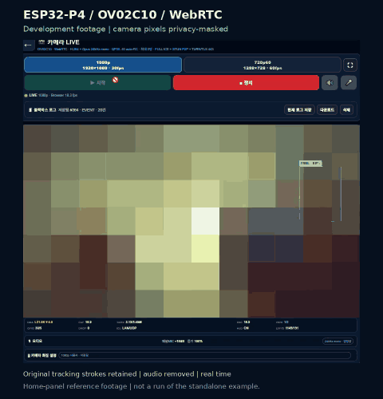

# Home-panel development footage

[Watch/download the 30-second MP4](home-panel-tracking-demo.mp4)

## What this shows

A continuous, real-time 30-second section (35–65 seconds) from an existing
home-panel browser recording uploaded on 2026-11-04. It illustrates the camera
UI and experimental tracking overlay during movement. It was recorded with
the larger home-panel project, not the standalone public example.
This is development footage, not a demonstration of guaranteed OWNER identity,
recognition accuracy, liveness detection, anti-photo protection or FPS/latency.
The source UI's live status values are observations from that recording.

## Privacy treatment

- Browser tabs, bookmarks, address bar and side panels are cropped out.
- The full camera image is strongly pixelated to 12x7 color blocks in every
  frame; faces, photographs and home details are not shown at source resolution.
- Only long saturated green/cyan overlay strokes are retained as flat colors;
  no original camera pixels are restored inside the masked camera rectangle.
  Green/cyan categories are kept separate; other overlay detail may be lost.
- All audio and source container metadata are removed.
- The public files contain only this edited excerpt. The original videos are
  not included in this repository.

The MP4 is H.264, 960x1000 at 12 fps, 30 seconds, without audio. The preview GIF
is 480 pixels wide at 4 fps and loops the same excerpt. Frame rates describe
these edited media files, not measured camera streaming throughput.

한국어: 기존 홈패널의 개발 영상을 편집한 자료입니다. 주소·얼굴·가족 사진·음성
공개를 피하도록 처리했습니다. 새 공개 예제의 실기 검증 영상이나 인식 정확도
보증 자료는 아닙니다. 추적 표시의 움직임을 참고하는 용도입니다.
